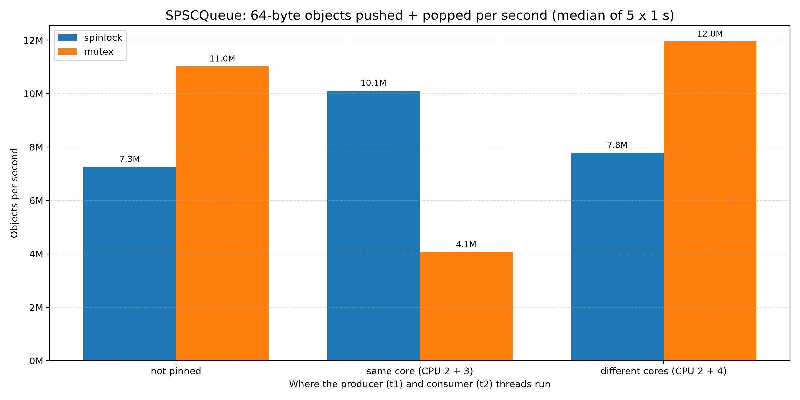

# Student details
- email: varun.24bcs10009@sst.scaler.com
- roll_no: 24BCS10009

# SPSC Queue with locks (spinlock vs std::mutex)

A single-producer / single-consumer (SPSC) queue protected by a lock, and a benchmark that
answers the assignment question: **how many 64-byte objects can be pushed and popped in
1 second?**

The queue is measured with both kinds of lock the assignment allows:
- a **spinlock**: a `while` loop that keeps trying until the lock is free, and
- **`std::mutex`**: the OS puts a waiting thread to sleep and wakes it up later.

## Result (per-second specs)

Median of 5 runs of 1 second each. Each object counted was pushed by `t1` **and** popped
by `t2`; total queue operations per second are twice these numbers.

| Where t1 (producer) and t2 (consumer) run | spinlock | std::mutex |
|---|---:|---:|
| not pinned (OS decides) | **7.3 M objects/s** | **11.0 M objects/s** |
| same physical core (two hyper-threads, CPU 2 + 3) | **10.1 M objects/s** | **4.1 M objects/s** |
| different physical cores (CPU 2 + 4) | **7.8 M objects/s** | **12.0 M objects/s** |



**Machine:** AMD Ryzen 9 5900HX (8 cores / 16 threads), Ubuntu 24.04, g++ 13.3, `-O2` Release build.

Every run also checks that all objects arrived **in order, with none lost or duplicated**.
All runs passed.

## Files

- `spscqueue.h`: the queue. `SPSCQueue<T, Capacity, Lock>` is a fixed-size ring buffer;
  the lock is a template parameter (`SpinQueue<T, N>` uses the spinlock,
  `MutexQueue<T, N>` uses `std::mutex`). It also contains the `SpinLock` class.
- `main.cpp`: the benchmark. Thread `t1` pushes 64-byte objects and thread `t2` pops them
  for the given time, then `t1.join()` and `t2.join()`.
- `tests.cpp`: correctness tests (empty/full queue, FIFO order, wrap-around, and a
  two-thread test that pushes 1,000,000 numbers through a 16-slot queue).
- `benchplot.py`: runs every case 5 times and draws `benchmark.png`.

## How it works

- **Ring buffer allocated once.** The queue owns 65,536 slots of 64 bytes (4 MiB),
  allocated on the heap when it is created. `push` and `pop` never allocate memory; they
  only copy an object into or out of a slot. `head` counts objects popped and `tail`
  counts objects pushed, so the queue is empty when `head == tail` and full when
  `tail - head == Capacity`.
- **One lock around every operation.** `push` and `pop` each take the lock with
  `std::lock_guard`, so the producer and consumer never read and write `head`/`tail` at
  the same time. Because the lock is a template parameter, the spinlock and the mutex run
  exactly the same queue code.
- **Spinlock.** `lock()` tries `exchange(true)`; if the lock was taken, it waits in a
  `while` loop that only *reads* the flag (cheap) and calls `_mm_pause()`. It tries the
  exchange again only once the lock looks free (test-and-test-and-set).
- **The object.** `struct BigObject { uint64_t seq; char payload[56]; }` is exactly
  64 bytes. `seq` is 0, 1, 2, …, so the consumer can check the order.
- **Fair measurement.** Both threads wait for a start flag. `main` sleeps for the time
  limit and then tells the producer to stop. The consumer drains whatever is left, and
  both threads are joined. Each thread keeps its counters in local variables, so the
  counters don't share a cache line while the test runs.

## Why the results look like this

During the run the queue is almost always **full**: the consumer is the slower side.
In a typical 1-second run there are 0 failed pops, but hundreds of thousands (mutex)
to millions (spinlock) of failed pushes. The
producer keeps taking the lock just to find there is no space, and that fight over the
lock decides the result:

- **Different cores: mutex wins (12.0 M vs 7.8 M).** With the spinlock, every failed
  push from the producer pulls the lock's cache line over to the producer's core, and the
  consumer then has to pull it back before it can pop. Each pop pays for a cache-line
  transfer between cores. With `std::mutex`, a producer that finds the lock taken gets
  put to sleep (about 1,800 context switches per second, measured with
  `perf stat -e context-switches`). While it sleeps, the consumer pops many objects in a
  row with the lock already in its own cache.
- **Same core: spinlock wins (10.1 M vs 4.1 M).** Two hyper-threads on one core share
  the same L1 cache, so passing the lock between them costs almost nothing, and
  `_mm_pause()` hands the core's resources to the other thread while spinning. The
  mutex's sleep/wake system calls are now by far the largest cost.
- **Not pinned:** the OS usually puts the two busy threads on different cores, so the
  results look like the "different cores" case.

## Build and run

```bash
cmake -S . -B build
cmake --build build

./build/SPSCQueue                    # 1 second with the spinlock, then 1 second with std::mutex
./build/SPSCQueue 1000 spinlock      # <milliseconds> <spinlock|mutex|both>
./build/SPSCQueue 1000 mutex 2 4     # optionally pin t1 to CPU 2 and t2 to CPU 4
./build/spsc_tests                   # correctness tests
```

The build type defaults to Release (`-O2`); benchmark numbers from a Debug build are much lower.

Sample output:

```
Lock: mutex
Time allowed (in ms): 1000
Producer CPU: 2, consumer CPU: 4 (-1 = not pinned)
Push operations: 12515144
Pop operations: 12515144
Total ops: 25030288
64-byte objects pushed+popped per second: 12508460
Ops per second (push + pop): 25016920
Failed pushes (queue full): 562290
Failed pops (queue empty): 0
FIFO check: PASS (0 out of order)
```

To redraw the chart (needs matplotlib): `python3 benchplot.py`. The CPU numbers in it
assume CPUs 2 and 3 are hyper-threads of one core; check yours with `lscpu -e`.

### Checking for data races

```bash
cmake -S . -B build-tsan -DSPSC_TSAN=ON && cmake --build build-tsan
setarch -R ./build-tsan/spsc_tests
```

ThreadSanitizer reports no data races. As a sanity check, deleting the `lock_guard` from
`pop()` makes it report a data race straight away. `setarch -R` turns off address
randomisation for that one process, which ThreadSanitizer needs on newer Linux kernels.

## Future improvements

- **Back off when the queue is full.** The producer wastes most of its lock grabs on
  failed pushes. Spinning a few `_mm_pause()` iterations, or waiting on a condition
  variable, before retrying would leave the lock to the consumer.
- **Push/pop in batches.** Moving several objects per lock acquisition would split the
  cost of each lock over many objects.
- **Hybrid lock.** Spin for a short time and only then go to sleep (roughly what a
  "mutex with spinning" does), to get the spinlock's same-core speed and the mutex's
  cross-core behaviour.
